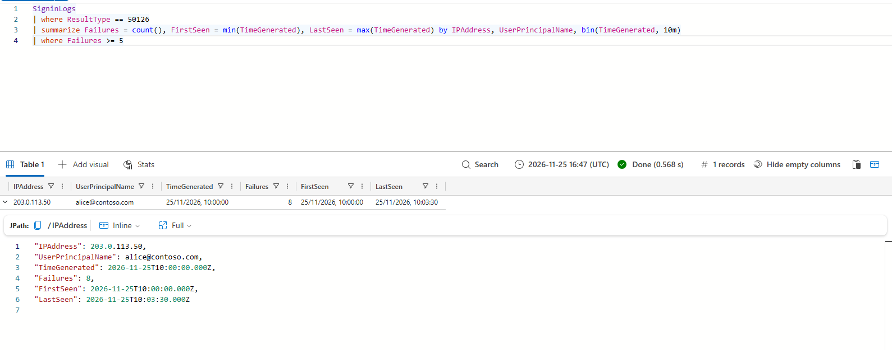
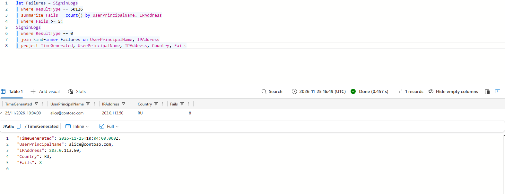
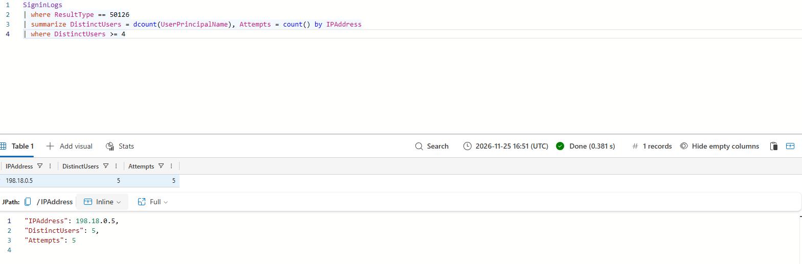
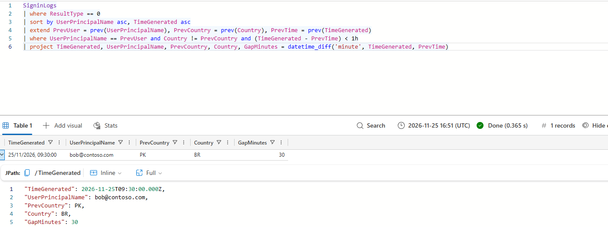

# KQL Detection Rules for Microsoft Sentinel

A small collection of KQL detection queries for common identity-based attacks, mapped to MITRE ATT&CK. Built as a learning project to practice detection engineering.

> **Note:** All data in this repo is **synthetic** (generated by me). No real user or company data is used.

## Environment
- Azure Data Explorer (free cluster), database `SecLab`
- Table: `SigninLogs`, modeled on the Microsoft Entra ID sign-in log schema used in Microsoft Sentinel
- Some column names may differ slightly from a live Sentinel workspace
- `ResultType 50126` = invalid username or password; `0` = successful sign-in

## Detections

| # | Detection | MITRE ATT&CK | Logic |
|---|-----------|--------------|-------|
| 1 | Brute force | T1110.001 | 5+ failed logins from one IP against one user within 10 minutes |
| 2 | Success after repeated failures | T1110 / T1078 | Successful login from an IP that previously had 5+ failures |
| 3 | Password spray | T1110.003 | One IP failing against 4+ different users |
| 4 | Impossible travel | T1078 | Same user succeeds from two countries within 1 hour |

## How to reproduce
1. Create a free Azure Data Explorer cluster and a database named `SecLab`.
2. Run `data/create_sample_data.kql` to create the `SigninLogs` table.
3. Run each query in `queries/` and compare with the expected results below.

## Results

### 1. Brute force
- **What it detects:** repeated failed logins against one account.
- **Result:** flags `203.0.113.50` with 8 failures against `alice@contoso.com`.
- 

### 2. Success after failures
- **What it detects:** a possible account compromise after a brute-force attempt.
- **Result:** flags alice's successful login right after the failures.
- 

### 3. Password spray
- **What it detects:** one IP failing logins against 4 or more different user accounts.
- **Result:** flags 5 attempts from IP `198.18.0.5` on 5 distinct user accounts.
- 

### 4. Impossible travel
- **What it detects:** login from two different countries within 1 hour.
- **Result:** flags login by `bob@contoso.com` from countries `PK` and `BR` with a 30-minute gap.
- 

## False positives and tuning
- Users who mistype passwords or forget them can trigger rule 1. Raise the threshold or exclude known corporate IPs.
- VPN users can trigger impossible travel. Exclude known VPN IP ranges.

## What I learned
- **`summarize`:** Before this project I counted rows and calculated values like max, min and sum by hand. With `summarize`, one line of KQL gives me things like failed attempts per user, which makes suspicious activity easy to spot.
- **`bin()`:** Grouping events into fixed time windows shows activity spikes. This helps separate a normal human login pace from an automated brute-force attempt.
- **`join`:** Combining data from two sets made the queries much more powerful. For example, I could find successful sign-ins that came after repeated failures.

## Repository structure
- `data/` – synthetic data generation script
- `queries/` – detection queries (.kql)
- `screenshots/` – query results

## Next steps
- Add off-hours login and rare-country login detections
- Convert these queries into Sentinel analytics rules
- Add a Logic App playbook that sends alerts to Teams
